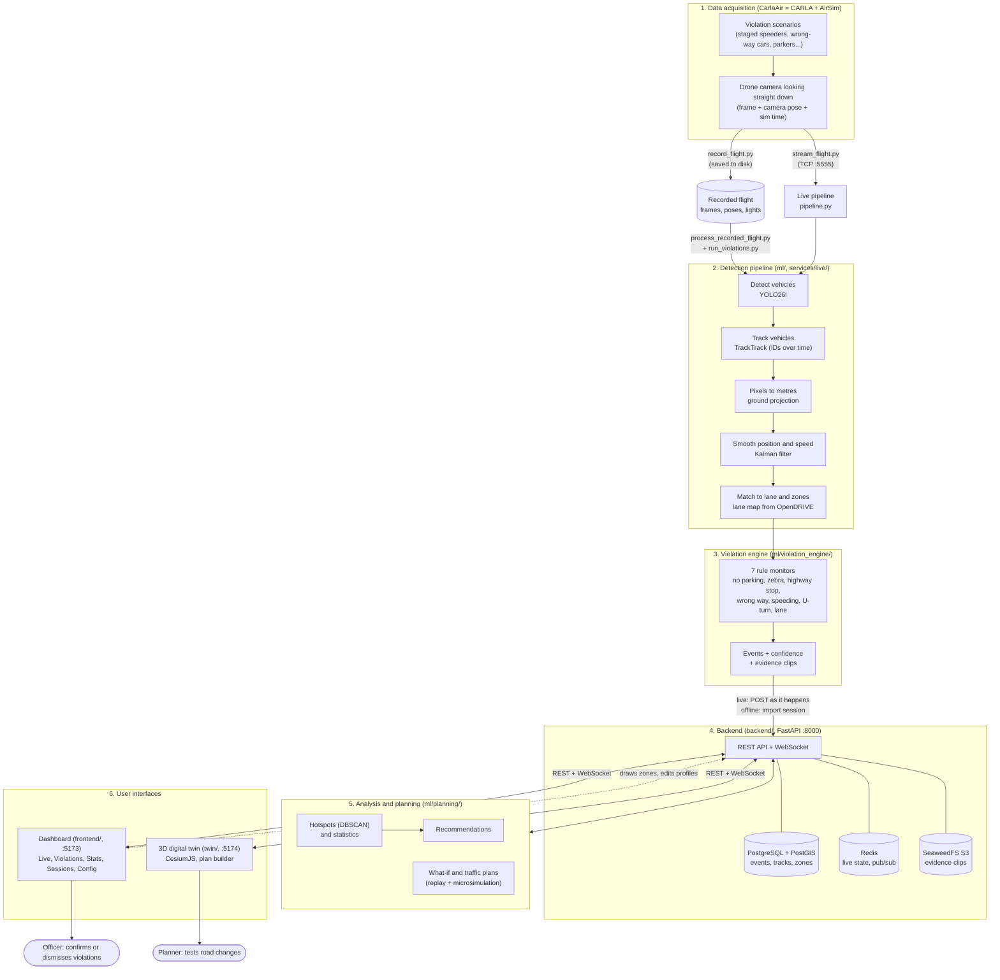
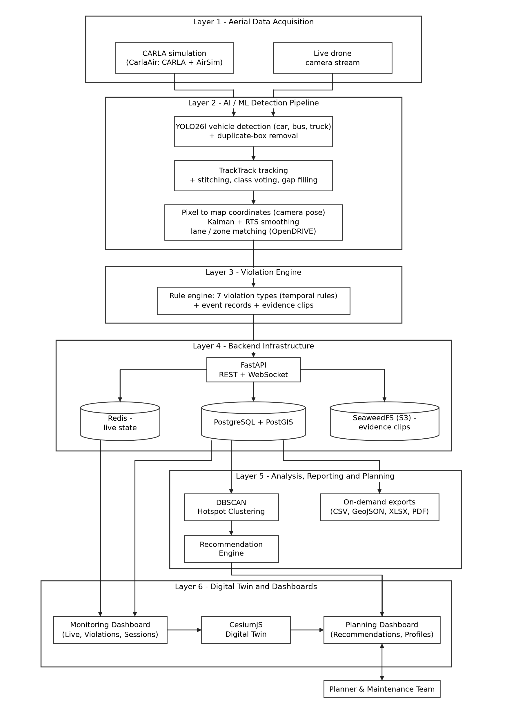
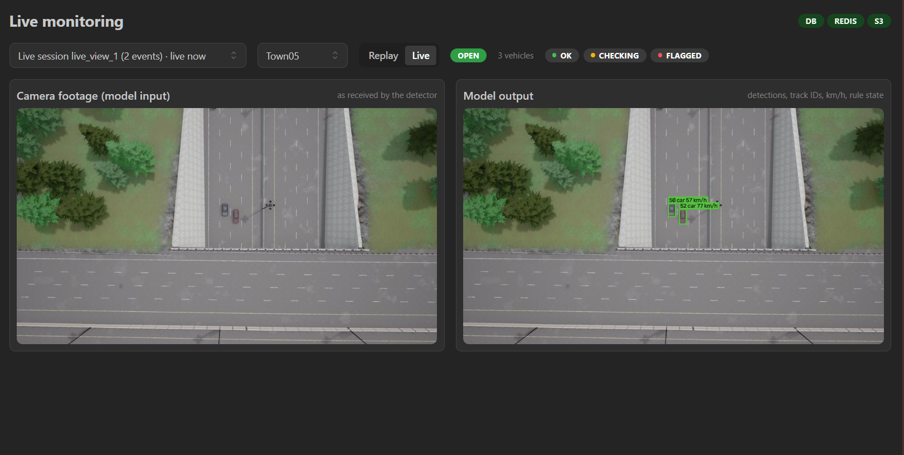
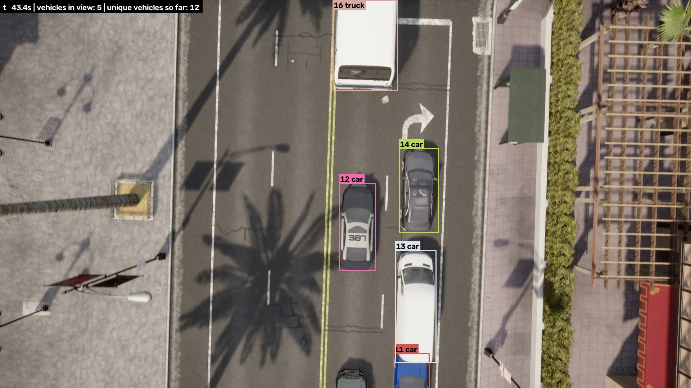
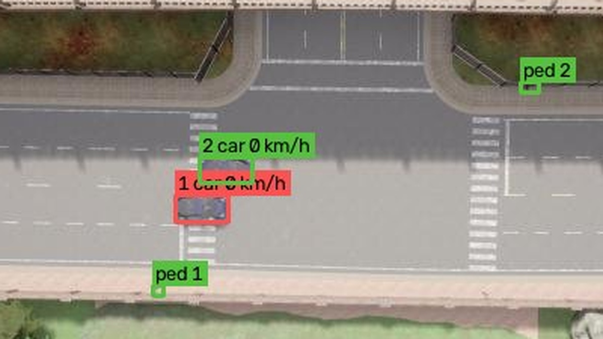
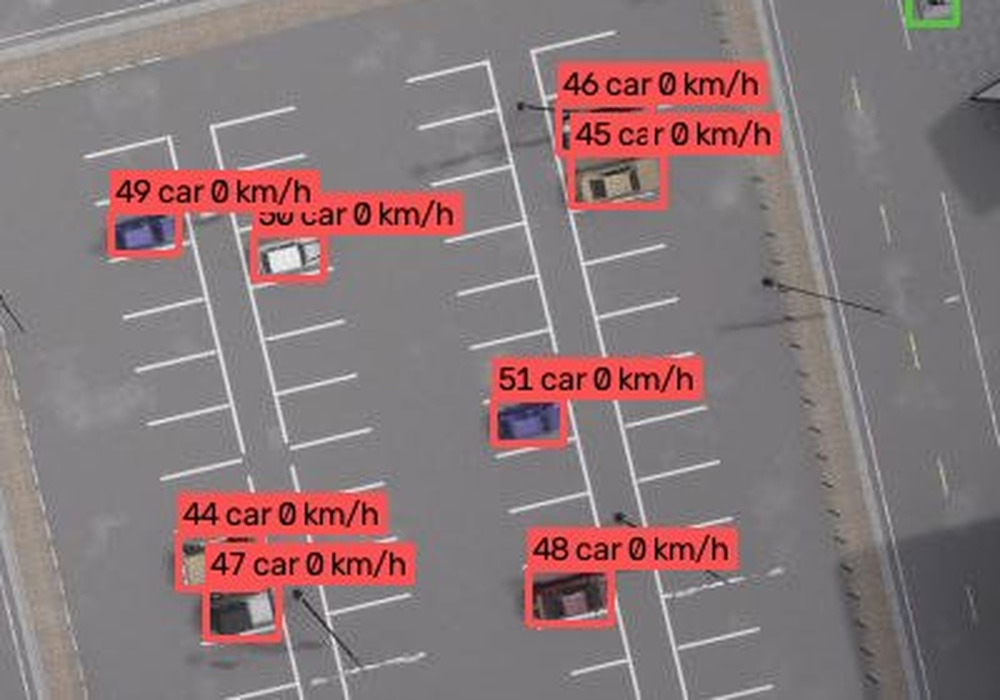
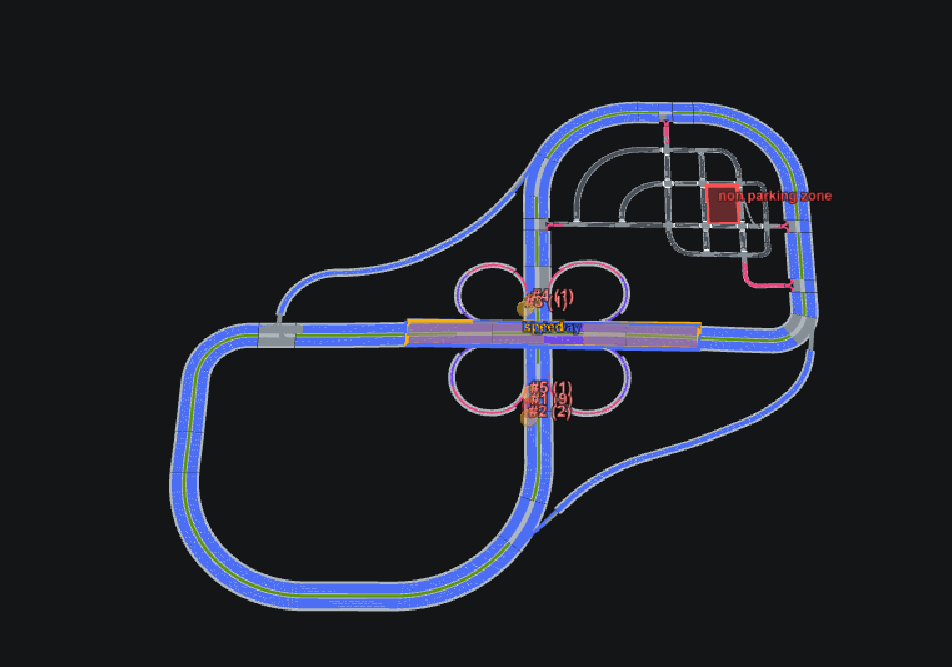
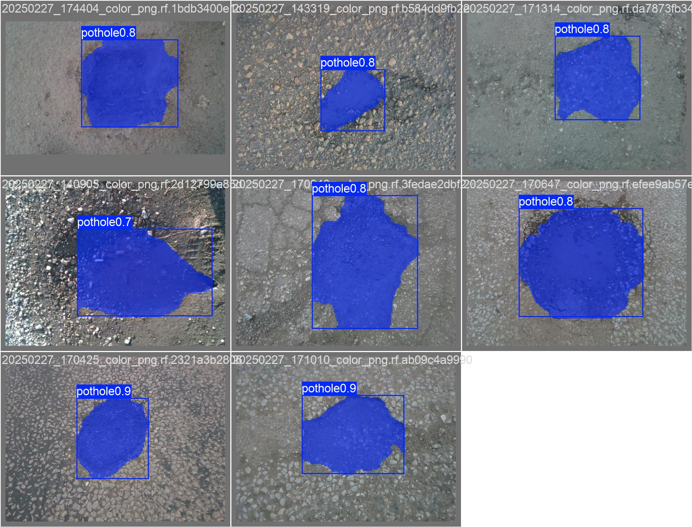

# Aerial Traffic Violation Detection and Urban Planning

**A drone looks down at the road. The system finds traffic violations and helps planners improve the road.**

A camera on a drone (simulated in CARLA) films traffic from above. The system:

1. **Finds every vehicle** in each frame (YOLO26l detector).
2. **Follows each vehicle** over time and gives it an ID (TrackTrack tracker).
3. **Converts pixels to metres** on the map, so it knows each car's position, speed and lane.
4. **Checks traffic rules** (speeding, wrong way, illegal parking, and more) and records each violation with a video clip as evidence.
5. **Shows it all** on a web dashboard and a 3D digital twin, where officers review violations and planners test changes to the road.

It works in two modes:

| Mode | What it does | Speed |
|---|---|---|
| **Live** | The drone streams frames, and violations show up on the dashboard within about 1–2 s | Real time |
| **Offline** | A recorded flight is processed in one pass, then imported into the dashboard | More accurate |

---

## How it works



### The violations it detects

| Rule | Flagged when |
|---|---|
| **No parking** | Stopped in a no-parking zone for 30 s or more |
| **Zebra crossing** | Stopped on a crossing for more than 10 s (not just queued in traffic) |
| **Highway stop** | Below 5 km/h on a highway lane for more than 20 s (stops on the shoulder are marked *possible breakdown*) |
| **Wrong way** | Driving against the lane direction (more than 150°) for at least 5 m |
| **Speeding** | Faster than the lane's speed limit |
| **Illegal U-turn** | U-turn where it is not allowed |
| **Lane violation** | Crossing a solid line, or riding over a lane line |

Each threshold can be changed in a **configuration profile** from the dashboard.

### Architecture (six layers)



---

## Screenshots

### Live monitoring dashboard
The drone's camera view on the left, and the model's output on the right (track ID, class and speed for every vehicle).



### Vehicle detection and tracking
Each vehicle gets a box, a class and an ID that stays with it from frame to frame.



### Violations being flagged
Red means flagged. On the left, a car stopped on a zebra crossing. On the right, cars parked in a no-parking area.

| Stopped on a zebra crossing | Parked in a no-parking zone |
|---|---|
|  |  |

### Digital twin (lane map)
Lanes from the OpenDRIVE map, with drawn zones (such as a no-parking zone) and violation markers.



### Road anomaly (pothole) detection
A segmentation model outlines potholes in road images.



---

## Repository layout

| Folder | What's inside |
|---|---|
| [ml/detection/](ml/detection/) | Detector training, dataset building, detection reports |
| [ml/violation_engine/](ml/violation_engine/) | Tracking configs, ground projection, smoothing, lane maps, **the rule engine**, offline runners, evaluation tools |
| [ml/planning/](ml/planning/) | Hotspots, recommendations, what-if, traffic plans, microsimulator |
| [ml/pothole/](ml/pothole/) | Road-anomaly (pothole) detection |
| [services/live/](services/live/) | Live pipeline: TCP frame transport, detector loop, backend client, watchdog |
| [simulation/](simulation/) | CARLA scripts: record or stream flights, fly the drone, staged violation scenarios |
| [backend/](backend/) | FastAPI service, database models, import, live WebSocket, exports (PDF/XLSX/CSV/GeoJSON) |
| [frontend/](frontend/) | React dashboard (Vite + Mantine) |
| [twin/](twin/) | 3D digital twin (CesiumJS + Vite) |
| [schemas/](schemas/) | JSON schemas for events, profiles, scenes |
| [infra/](infra/), [docker-compose.yml](docker-compose.yml) | PostGIS, Redis and SeaweedFS for local development |
| [scripts/](scripts/) | One-click start/stop of the Town04 live demo |
| [docs/](docs/) | Requirements, plans, technical guide, progress tracker |

---

## Getting started

### What you need

- Windows 11 with an NVIDIA GPU
- Python 3.10+ (main `venv`) and the `carlaAir` conda env for the simulator scripts
- Node.js 18+
- Docker Desktop
- CarlaAir v0.1.7 (in `CarlaAir-v0.1.7-Windows11-x86_64/`)

### 1. Install

```powershell
python -m venv venv
venv\Scripts\python.exe -m pip install -r requirements.txt -r backend/requirements.txt
cd frontend; npm install; cd ..
cd twin; npm install; cd ..
```

### 2. Start the services and the backend

```powershell
docker compose up -d                                          # PostGIS :5432, Redis :6379, S3 :9000
venv\Scripts\python.exe -m uvicorn backend.app.main:app --port 8000
# API docs: http://localhost:8000/docs
```

### 3. Start the dashboard and the twin

```powershell
cd frontend; npm run dev        # http://localhost:5173
cd twin;     npm run dev        # http://localhost:5174
```

No backend? Run `npm run dev:mock` in `frontend/` to get generated test data.

### 4a. Live demo (one click)

```powershell
powershell -ExecutionPolicy Bypass -File scripts\start_town04_live.ps1
```

This starts CarlaAir on Town04, the Docker stack, backend, dashboard, live pipeline, every violation scenario and the drone controls. It skips anything already running. Fly the drone with `fly_drone.py` (A = take off), or jump to a spot with `scripts\goto_spot1.bat` (also `2` and `3`). To stop:

```powershell
powershell -ExecutionPolicy Bypass -File scripts\stop_town04_live.ps1
```

For a two-PC setup (simulator on one machine, detector on another), see [docs/Two_Machine_Live_Test.md](docs/Two_Machine_Live_Test.md).

### 4b. Offline (recorded flight)

```powershell
# detect + track a flight from simulation/data_export/recorded_flights/<id>/
venv\Scripts\python.exe ml/violation_engine/process_recorded_flight.py <flight_id>

# run the rules
venv\Scripts\python.exe ml/violation_engine/run_violations.py <flight dir> --scene ml/violation_engine/configs/scenes/Town05.json
```

Then import it from the dashboard's **Sessions** page, or call `POST /api/sessions/import`.

### Tests

```powershell
venv\Scripts\python.exe -m pytest backend/tests ml/violation_engine/tests
cd frontend; npm test
cd twin; npm test
```

---

## Learn more

| Document | Read it for |
|---|---|
| [docs/System_Technical_Guide.md](docs/System_Technical_Guide.md) | Every part in detail: algorithms, parameters, file map |
| [docs/Project_Explanation_Study_Guide.md](docs/Project_Explanation_Study_Guide.md) | A plain-language walkthrough of the project |
| [docs/Product_Requirements_Document.md](docs/Product_Requirements_Document.md) | Full requirements |
| [docs/Violation_Engine_Architecture.md](docs/Violation_Engine_Architecture.md) | How the rule engine is built |
| [backend/API.md](backend/API.md) | REST and WebSocket API |
| [docs/main_project_tracker.md](docs/main_project_tracker.md) | Progress log and experiment results |
